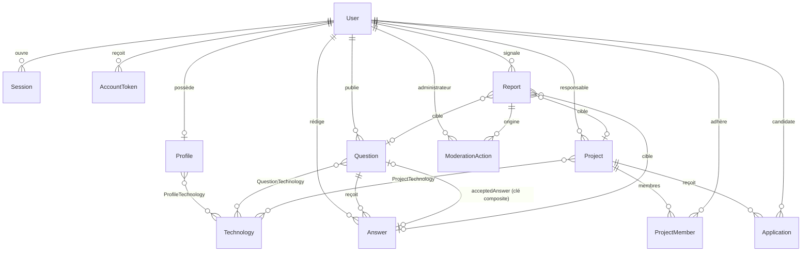

# Modèle de données

Source de vérité : `backend/prisma/schema.prisma` et les migrations versionnées de `backend/prisma/migrations/`. Les choix encore ouverts sont listés dans la [décision 002](../decisions/002-modele-donnees.md). Le registre Teranga Points est ajouté au lot 19 selon la [décision 004](../decisions/004-teranga-points.md).

## Entités

| Entité | Champs principaux | Contraintes en base |
|---|---|---|
| User | email, username, usernameKey, passwordHash, role, status, emailVerifiedAt | email unique et normalisé (CHECK) ; usernameKey unique, égal à `lower(username)` (CHECK) |
| Profile | userId (clé), bio ≤ 500, countryCode, links | countryCode ISO alpha-2 majuscule (CHECK) ; 3 liens au plus (CHECK) |
| Session | tokenHash (SHA-256), userId, expiresAt, lastSeenAt, revokedAt | tokenHash unique ; expiresAt > createdAt (CHECK) |
| AccountToken | tokenHash, userId, purpose, expiresAt, consumedAt | tokenHash unique ; index (userId, purpose) |
| Technology | name, slug | name et slug uniques |
| Question | authorId, title ≤ 150, context, expected, actual, attempts, code, visibility, acceptedAnswerId | FK composite (acceptedAnswerId, id) vers Answer(id, questionId) |
| Answer | questionId, authorId, body, code, visibility | UNIQUE(id, questionId) servant de cible à la FK composite |
| Project | ownerId, title, objective ≤ 5000, availability ≤ 300, recruitmentStatus, visibility | index de liste (visibility, recruitmentStatus, createdAt, id) |
| ProjectMember | (projectId, userId), joinedAt | clé primaire composite : une adhésion par couple |
| Application | projectId, applicantId, message ≤ 1000, status, decidedAt | UNIQUE(projectId, applicantId) ; `PENDING` si et seulement si decidedAt est nul (CHECK) |
| Report | reporterId, questionId / answerId / projectId, reason, status, decision, closedById, closedAt | exactement une cible (CHECK) ; clôture complète ou absente (CHECK) ; un signalement OPEN par déclarant et cible (3 index uniques partiels) |
| ModerationAction | adminId, decision, reason, reportId, questionId / answerId / projectId / targetUserId | exactement une cible (CHECK) ; `SUSPEND_ACCOUNT` si et seulement si la cible est un compte (CHECK) |

Identifiants UUIDv7 générés par l'application (ordonnés dans le temps, opaques pour l'API). Dates `timestamptz(3)`, exposées en ISO 8601 UTC.

## Invariants et responsabilités

| Invariant | Garanti par |
|---|---|
| Solution acceptée appartenant à sa question | Base (FK composite) |
| Solution acceptée visible ; masquage d'une solution qui retire la référence | Transaction du service JokkoHelp |
| Statut résolu | Calculé : `acceptedAnswerId IS NOT NULL`, aucun second état stocké |
| Une candidature par membre et projet, même après refus ou retrait | Base (UNIQUE) |
| Une adhésion par membre et projet ; responsable membre dès la création | Base (clé composite) et transaction de création du projet |
| Acceptation de candidature et création d'adhésion atomiques | Transaction avec mise à jour conditionnelle sur `status = 'PENDING'` |
| Cible de signalement unique et existante | Base (CHECK et FK) |
| Un signalement ouvert par déclarant et cible | Base (index uniques partiels) |
| Formes normalisées de l'email et du pseudonyme | API (normalisation) et base (CHECK de cohérence) |

## Politique de suppression

F2 ajoute `QuestionPublication` : clé primaire `(userId, action, key)`, empreinte SHA-256, question unique, dates de confirmation et de conservation. Publication et reçu partagent la même transaction ; références RESTRICT vers compte et question. Aucune copie du texte dans le reçu. Les suppressions logiques restent inchangées ; une suppression physique doit respecter les reçus encore nécessaires. Reprise sept jours, purge minimale préparée à huit jours, sans timer activé. Voir la [décision 010](../decisions/010-question-pending-publication.md).

Aucune cascade sur les contenus publiés : supprimer un compte, une question, une réponse ou un projet référencé est refusé (`RESTRICT`). La modération masque (`visibility = HIDDEN`) et conserve l'historique. Les cascades se limitent aux données qui n'ont pas d'existence propre : profil, sessions et jetons d'un compte, liaisons de technologies d'un contenu. La suppression de compte reste une décision produit ouverte.

## Contraintes hors Prisma

La suppression physique reste soumise aux restrictions ci-dessus. Le lot17 ajoute une suppression logique propriétaire des seules questions et projets via `deletedAt`, indépendante de `visibility`. Migration additive `20261022020000_owner_content_deletion`, aucune FK ou ligne retirée. Voir la [décision004](../decisions/004-owner-content-deletion.md) pour les transactions, répétitions et projections privées. Réponses, membres, candidatures, signalements et historiques conservés.

Les CHECK et les index uniques partiels sont écrits en SQL à la fin de la migration `init`. Prisma ne les gère pas mais ne les considère pas comme une dérive : `prisma migrate diff` entre la base migrée et le schéma est vide (vérifié le 17 octobre 2026). Toute nouvelle contrainte de ce type doit être ajoutée de la même manière, dans une migration relue, et couverte par `backend/test/database.integration.ts`.

## Index de listes

Tri stable `createdAt DESC, id DESC` pour les questions et projets publics (index préfixés par `visibility`), files de signalements par `status`, candidatures reçues par `(projectId, status, createdAt)` et suivies par `(applicantId, createdAt)`. Toutes les clés étrangères utilisées en filtre sont indexées. La recherche textuelle MVP reste une requête paramétrée sur titre et contenu ; un index plein texte sera ajouté seulement après mesure.

Lot18 : migration additive `20261022050000_profile_photo_contact`, clé photo nullable unique sur User et réglages facultatifs de contact privé sur Profile, partage false par défaut. Les fichiers JPEG normalisés sont hors base dans un stockage durable dédié ; les sauvegardes doivent couvrir DB et fichiers de façon cohérente. Le contact n’est exposé dans aucune projection publique ; accès selon les participations réelles à un projet visible non supprimé. Voir [décision005](../decisions/005-profile-photo-collaboration-contact.md).
## Registre Teranga Points — lot 19

Migration additive `20261022160000_teranga_points` : `ReputationEvent`, `ReputationReason`, références restrictives vers utilisateur/question/réponse, unicité réponse/séquence, delta non nul et motifs cohérents. Aucun changement des migrations partagées, de `deletedAt`, des photos ou contacts. Un trigger refuse UPDATE/DELETE/TRUNCATE. La somme par bénéficiaire est le score, sans compteur redondant. Voir [décision 004](../decisions/004-teranga-points.md) pour l’ordre de verrouillage et la reconstruction append-only.
