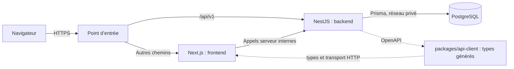

# Architecture du socle

Une application Next.js sert les espaces public, développeur et administrateur. Les groupes de routes n’ajoutent aucun segment : /, /connexion, /espace et /admin sont distincts. Les layouts ne protègent pas l’accès ; leurs pages ne contiennent aucune donnée privée.

En local, Next.js porte le proxy /api/v1 vers 127.0.0.1:3001 ; pas de route Next.js concurrente sous ce préfixe. Le navigateur utilise une origine unique. Les composants serveur utilisent API_INTERNAL_ORIGIN. Les futurs appels privés transmettront explicitement le cookie de la requête, jamais un cookie global. Tous les appels HTTP centralisés sont no-store ; les caches publics futurs devront être explicitement conçus.

Ousmane possède frontend/, l’intégration et la coordination ; Serge possède backend/, PostgreSQL, l’authentification et la sécurité backend. packages/api-client/ constitue le point de synchronisation. Aucun runtime backend ni modèle Prisma n’est partagé avec le navigateur.

JokkoHelp : questions, réponses, solution acceptée. JokkoProjects : projets, candidatures, recrutement et membres. Signalements et modération minimale appartiennent au MVP. Teranga Points reste conditionnel : futur domaine backend/src/modules/teranga-points si approuvé, présentation dans l’espace développeur ; aucun dossier de module, modèle, table ni calcul n’est créé.
